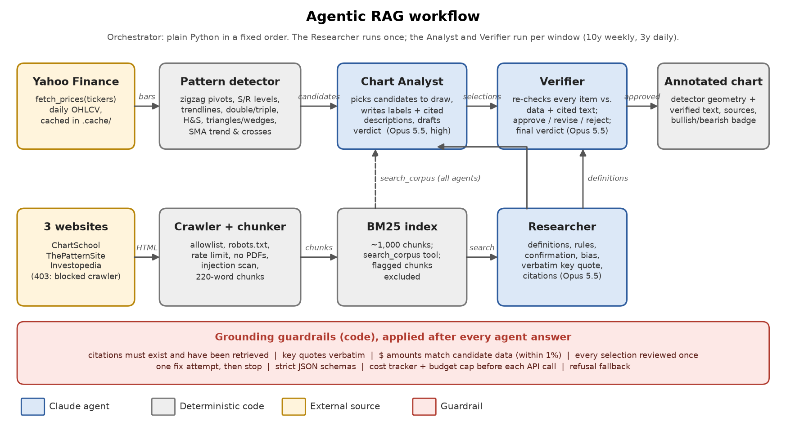

# Agentic RAG Chart-Pattern Prototype

Pulls daily prices for any ticker, charts the last 10 years (weekly bars) and 3 years (daily bars),
and annotates each chart with support/resistance, trendlines and chart patterns. Every note cites
StockCharts ChartSchool or ThePatternSite, retrieved through a RAG corpus, and each chart gets a
bullish/bearish verdict.

**Educational prototype. Not financial advice.**

## The RAG system and its three agents

The system answers one question per chart: *which chart patterns are present, what do the
reference sites say they mean, and is the chart bullish or bearish?* It splits that job
three ways:
- **Plain Python** handles everything mechanical: fetching prices, crawling the sites,
  finding patterns, drawing charts.
- **Retrieval (RAG)** supplies the definitions, so explanations come from the reference
  sites rather than the model's memory.
- **Three Claude agents** do the parts that need judgment.

### 1. The knowledge base (the "R" in RAG)

`src/rag_charts/corpus.py` crawls the reference sites, then `src/rag_charts/retrieval.py`
indexes them:
- **Allowed hosts:** only the three requested sites, over HTTPS, after checking each site's
  robots.txt rules.
- **Polite crawling:** at most one request every 1.5 seconds per site, and no PDFs.
- **Pages:** 45 from StockCharts ChartSchool and 80 from ThePatternSite (Thomas Bulkowski).
  Investopedia refused the crawler and was skipped.
- **Chunks:** each page is cleaned and split into 220-word chunks with a 40-word overlap,
  about 1,000 in total.
- **Search:** chunks are indexed with **BM25** keyword search. Queries are full of exact
  terms ("neckline", "descending triangle"), which keyword matching handles well. BM25
  runs locally, needs no embeddings API, and gives the same results every time, so the
  retrieval evals are repeatable.
- **Tool access:** agents search the index through a `search_corpus` tool. Results come
  back wrapped as untrusted reference text, and any chunk that looks like a
  prompt-injection attempt is excluded.

### 2. Pattern detection (code, not agents)

Before any agent runs, `src/rag_charts/patterns.py` computes every number that will appear
on the chart:
- swing pivots
- support and resistance levels
- trendlines
- double and triple tops and bottoms
- head and shoulders (regular and inverse)
- triangles, wedges and channels
- the 50/200-day moving-average trend and the latest golden or death cross

Each finding becomes a *candidate* with an id, dated price points, metrics and a status
(confirmed, pending, failed). Agents can only describe these candidates; they can never
invent a price level.

### 3. The three agents

All three run on Claude Opus 5.5 with tools and return strict JSON. Their code is in
`src/rag_charts/agents.py`.

| Agent | Runs | Tools | What it does |
|---|---|---|---|
| **Researcher** | once per run | `search_corpus` | For each pattern type the detector found, searches the corpus and writes a definition, identification rules, how the pattern is confirmed, and whether it implies bullish, bearish or neutral. Each definition includes a short quote copied verbatim from a cited chunk. |
| **Chart Analyst** | once per chart | `search_corpus`, `get_candidate`, `get_price_window` | Reads the detection report and the definitions, then picks the 4–8 candidates that matter now: nearest support and resistance, live trendlines, the current formation, recent patterns. For each it writes a label and a cited description. It rejects candidates that don't meet the definitions, giving reasons, and drafts the bullish/bearish verdict. |
| **Verifier** | once per chart | `search_corpus`, `get_chunk`, `get_candidate`, `get_price_window` | Assumes nothing the Analyst wrote is correct. Re-reads each candidate's data and each cited passage, then approves, revises or rejects every item. It checks the verdict against the trend data and issues the final verdict. |

**Why three agents.** The fixed steps (fetch, crawl, detect, draw) are plain code, run by
a simple Python pipeline (`src/rag_charts/pipeline.py`). Agents are used only where
judgment is needed. The biggest risk in this task is confident text that drifts from the
data or misapplies a definition, which is why the Verifier is a separate agent with its
own tools. In testing it earned its place: the Analyst and Verifier rejected two shapes
the detector had built wrongly, and both detector bugs were then fixed. More agents (say,
one per pattern family) would add cost and coordination without adding accuracy.

### 4. Grounding checks (enforced in code)

After each agent answers, code checks the answer. A failing answer is sent back once with
the list of problems; a second failure stops the run.
- Every cited chunk id must exist **and** must have been retrieved during this run.
- The Researcher's key quotes must appear verbatim in a cited chunk.
- Every `$` amount in a description must match a price in that candidate's data, within 1%.
- The Verifier must review every Analyst selection exactly once.

### 5. Output

Approved items are drawn on the chart:
- **Geometry** comes from the detector.
- **Text and sources** come from the Verifier.
- **A verdict badge** goes in the corner.

Every API call's tokens and cost are logged by agent and tool. The full write-up, with
both annotated charts, eval results and costs, is in `outputs/Agentic_RAG_Overview.pdf`.

## Commands

Always go through `./run.sh`. It keeps the pip, yfinance and matplotlib caches and the
temp files inside `.cache/`.

| Step | Command | Cost |
|---|---|---|
| Plain 10y and 3y close charts for any ticker(s) | `./run.sh scripts/plot_prices.py SPY QQQ` | free |
| Build the RAG corpus (crawl about 4 min) | `./run.sh scripts/build_corpus.py` | free |
| Full pipeline and annotated charts | `./run.sh scripts/run_pipeline.py SPY` | ~$0.70 |
| Redraw charts from the last run | `./run.sh scripts/redraw_charts.py` | free |
| Offline test suite (88 tests) | `./run.sh pytest` | free |
| Evals, free parts only | `./run.sh evals/run_evals.py --offline` | free |
| Evals, all | `./run.sh evals/run_evals.py` | ~$1.20 |
| Token cost report | `./run.sh scripts/cost_report.py` | free |
| PDF overview | `./run.sh scripts/make_pdf.py` | free |

The pipeline and the evals need `ANTHROPIC_API_KEY`. Each run stops before its next API
call once it reaches its budget: $6 per pipeline run and $8 per eval run, set in
`config.py`.

## Guardrails

- **Claude Code hook** (`.claude/settings.json` → `.claude/hooks/guard_paths.py`):
  - blocks file writes outside this folder
  - blocks every delete command, inside or outside
  - blocks Bash writes that mention outside paths
  - fails closed (blocks the call if it can't read it)

  Pattern matching on shell commands is a safety net, not a sandbox.
- **Application**:
  - every write goes through `guardrails.safe_path`
  - HTTPS allowlist of the three sites, robots.txt, rate limiting, no PDFs
  - prompt-injection scan of every chunk, and retrieved text is wrapped as untrusted data
  - strict JSON schemas
  - cost budget per run
  - refusal fallback

## Token cost tracking

Every API call goes to `logs/token_usage.jsonl` with exact token counts, cost, agent, turn,
and the tools it requested. Every tool execution goes to `logs/tool_calls.jsonl`.
`scripts/cost_report.py` writes per-run, per-agent, per-tool and per-model CSVs plus
`outputs/cost_breakdown.png`.

## Known limits

- Investopedia returns HTTP 403 to the crawler. The crawler logs it and skips the site;
  it does not get around the block. The corpus therefore covers two of the three sites.
- The detector reads closes only (no candlestick or volume rules), with simple documented thresholds.
